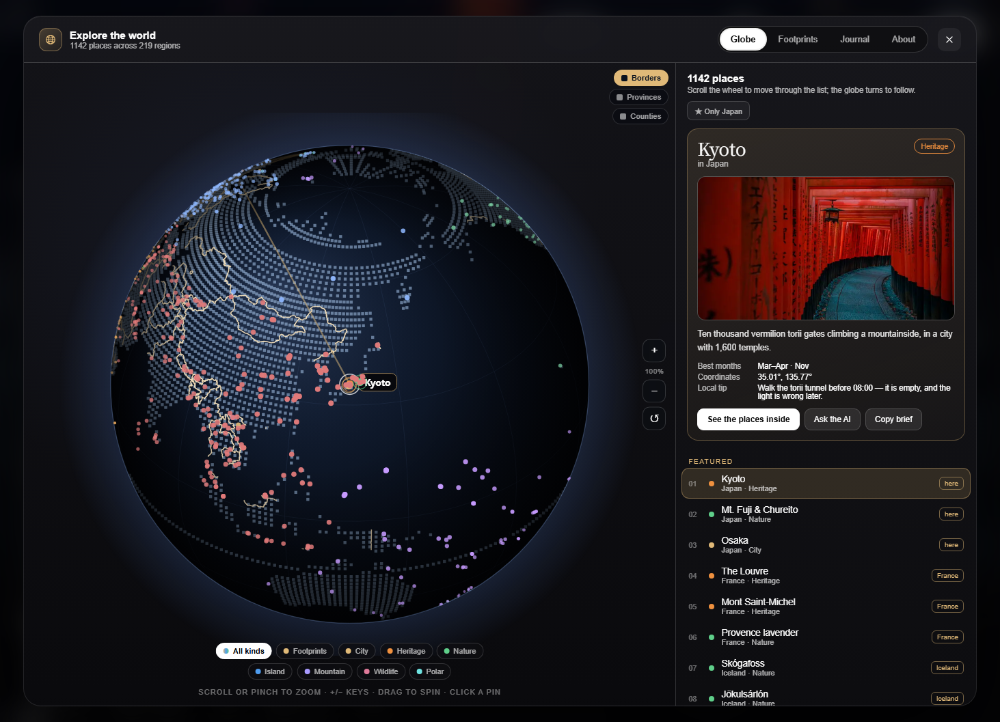

# TerraPortal

An immersive, single-page travel atlas — and a globe you fill in yourself.

Open it and you land inside a rotating portal window showing the country's map. Scroll
down and the places inside it slide up. Open the globe and every one of **1,148 places
across 207 countries** is pinned on a sphere you can spin, zoom and click.

Then the part this edition adds: **record where you have been**.



---

## What it does

### The atlas
- **207 countries**, each with a headline landmark on its own map, plus **1,148 places**.
  China and the USA carry 30 each, the big destinations 11–12, the rest 4–6.
- Every place: bilingual name and blurb, category, real coordinates, best months and a
  local tip. Every country: currency, visa, language, safety and a seasonal note.
- Photographs for **1,068 of 1,106** places, inlined as WebP and loaded on demand.
- 12 hand-built immersive destinations with procedural scenes, and six long-form
  travel guides.

### Footprints — your own layer
- Reachable from **Footprints in the top navigation**, the Footprints tab in the atlas,
  or Menu → My footprints.
- **Type a place and it pins itself.** The name is resolved against the built-in atlas
  index first (1,148 places and 207 countries), then against OpenStreetMap if it is
  somewhere else in the world. Coordinates are optional — fill them only if you want
  to be exact. The preview globe swings to the place and shows a pulsing pin before
  you even save.
- Attach a **photo**, a date and a note.
- Saved **entirely in your browser** — `localStorage` for the records, IndexedDB for the
  photos. Nothing is uploaded, and there is no account.
- Footprints are **joined in date order**, so filling in dates draws your route. The
  list shows places, countries and total distance travelled.
- The **preview globe is a real globe**: drag to spin it, scroll or pinch to zoom.
- **Export / import JSON**, with photos embedded, so you can back up or move devices.

### Map-grade borders and names
- **Country**, **province/state** and **county** boundaries, switchable from the globe,
  drawn as true great-circle-corrected polylines on the sphere.
- **Every administrative unit is labelled**: 258 countries, 4,589 provinces and 3,224
  counties. Labels are decluttered greedily in area order and each level has a zoom
  floor, so you read them by zooming — the same way Google and Apple Maps work. Nothing
  is missing from the data; at world view the small ones simply wait their turn.
- Switching on Provinces or Counties **rides the zoom in** to the level where that layer
  is legible, so it never looks like the switch did nothing.
- Province coverage is now worldwide from Natural Earth's 1:10m set (the 1:50m set only
  carries a subset and left Africa and South America blank). County coverage remains the
  **United States only** — that is the extent of the free data (see [CREDITS.md](CREDITS.md)).

---

## Run it

### One click

| Your system | Double-click this | What happens |
|---|---|---|
| **Windows** | `start.cmd` | starts a local server and opens your browser |
| **macOS** | `macos/TerraPortal.app` | a real app bundle — same, in a Terminal window |
| **Linux** | `./linux/install.sh` once, then the menu | adds an application entry with an icon |

Each launcher looks for a runtime in this order: **Node → Python 3 → Python**, and tests
it by *running* it — `python` on `PATH` is very often the Microsoft Store stub, which
opens the Store instead of serving anything. With neither installed it opens
`index.html` directly, which also works.

**Windows** — run `create-desktop-shortcut.cmd` once and a `TerraPortal` shortcut appears
on the Desktop.

**macOS** — the bundle is unsigned, so the first launch needs right-click → **Open**
(or `xattr -dr com.apple.quarantine macos/TerraPortal.app`). It opens a Terminal window
running the server, so closing that window stops it.

**Linux** — `linux/install.sh` writes `~/.local/share/applications/terraportal.desktop`,
installs the icon into the hicolor theme and adds a Desktop shortcut. `--remove` undoes
it; `--no-desktop` skips the Desktop copy.

The plain scripts also work anywhere: `start.cmd` (Windows), `start.command` (macOS),
`start.sh` (Linux).

```bash
# what the launchers actually run:
node serve.js            # serves this folder on 127.0.0.1:8731, opens the browser
node serve.js 9000       # a specific port
node serve.js --no-open  # headless, just print the URL
```

`serve.js` is ~120 lines of plain Node with no dependencies. It binds to `127.0.0.1`
only — nothing is exposed to your network — and walks to the next free port if 8731 is
taken.

### By hand

```bash
python3 -m http.server 8000    # any static server works
# open http://localhost:8000
```

…or just **open `index.html`** from your file manager. Everything works from `file://`
too, including the boundary layers, because they are loaded with a script tag rather
than `fetch`.

The one thing that needs a network is looking up a place that is **not** already in the
atlas: that falls back to OpenStreetMap's Nominatim, and offline it simply says it could
not find the place and leaves the coordinate fields for you to fill in by hand.

To publish, drop the whole folder on GitHub Pages, Netlify, or any static host.

---

## How it is built

| File | What it is |
|---|---|
| `index.html` | the whole app: markup, styles and logic in one file, ~1.4 MB |
| `assets/*.webp` | 1,118 photographs, fetched only when needed |
| `data/borders-admin0.js` | country boundaries, 117 KB |
| `data/borders-admin1.js` | province boundaries, 527 KB (global, 1:10m) |
| `data/borders-admin2.js` | county boundaries, 147 KB (US) |
| `data/labels-admin0.js` | 258 country names with anchor points, 8 KB |
| `data/labels-admin1.js` | 4,589 province names, 141 KB |
| `data/labels-admin2.js` | 3,224 county names, 95 KB |
| `serve.js` | the one-click local server, plain Node, no dependencies |
| `start.cmd` / `.command` / `.sh` | the launchers, one per platform |
| `create-desktop-shortcut.cmd` | puts a TerraPortal shortcut on the Desktop (Windows) |
| `macos/TerraPortal.app` | native macOS app bundle, own icon, opens Terminal |
| `linux/install.sh` | adds a Linux application entry and icon; `--remove` undoes it |
| `favicon.ico` | the globe mark, also used as the shortcut icon |

There is **no framework and no bundler**. The page is one `<script>`: a canvas renderer
for the globe and the portal, plus plain DOM for the panels.

The boundary layers and their place names are ~1.0 MB of geometry and text packed into
strings. Each polyline is a
run of base36 deltas on a 0.01° grid, decoded into unit vectors once, then rotated per
frame with the same math that draws the land dots. A layer is only fetched the first
time you switch it on.

### Data sizes

| | |
|---|---|
| Page (gzipped) | ~500 KB |
| First paint downloads | the page + **2** images |
| Boundaries + labels | lazy, 8 KB–527 KB per layer, on first use only |
| Photographs | 4–13 KB each, cached a year |

---

## Editing the atlas

The content lives in flat JavaScript structures inside `index.html`:

- `DEST` — one record per country/region: name, coordinates, facts, scene preset.
- `PLACES` — one record per place: `{ id, region, img, cat, lat, lon, name, months, blurb, tip }`.
- `ASSET` — image key → path. Add a file to `assets/` and an entry here.

Coordinates in the atlas were machine-checked against Natural Earth country polygons
(110m/50m/10m) with ray casting; the same test is worth running if you add places.

---

## A note on honesty

The atlas would rather tell you the truth than look complete:

- Some places have **no free photograph** anywhere (37 of them, mostly small Pacific
  atolls and Sahel parks). Those cards say so rather than showing something unrelated.
- 36 countries use a **same-country stand-in** image, captioned *"representative
  photograph of the country, not the landmark itself"*.
- 103 cards credit **Wikimedia Commons**, because Pexels had no coverage.

---

## License

**Code: MIT.** See [LICENSE](LICENSE).

That covers `index.html`, `serve.js`, the launchers, the generated boundary and label
data, and the atlas text. In short: use it, change it, ship it, sell it — just keep the
copyright notice.

**The photographs are not MIT.** They keep their own licenses, so the project as a whole
is *source-available under MIT with third-party assets*:

| What | License |
|---|---|
| code, boundary data, atlas text | MIT |
| ~1,015 photographs | Pexels License — free including commercial, but you may not resell an unaltered photo on its own |
| 103 photographs | Wikimedia Commons, mostly CC BY-SA 4.0 — attribution required, and the app captions those cards |
| Natural Earth geodata | public domain |
| OpenStreetMap Nominatim lookups | ODbL, © OpenStreetMap contributors |

[NOTICE](NOTICE) is the short version of exactly which files are which;
[CREDITS.md](CREDITS.md) has the per-source detail. **If you are publishing a
derivative, the simplest safe path is to replace `assets/` with your own photography.**

Place lookup for somewhere outside the atlas uses
[OpenStreetMap Nominatim](https://nominatim.org/). It is called only when you save or
leave a place field that the built-in index cannot resolve.
